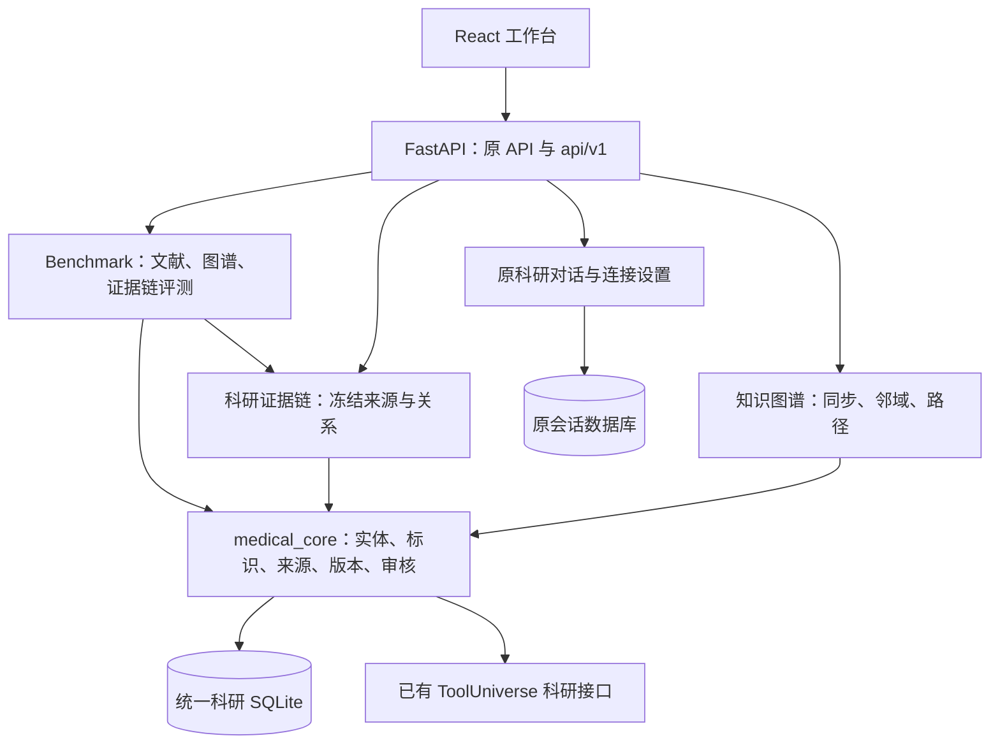

# 医学诊疗 Lab：统一科研平台实施记录

后续扩展：现已接入摘要级 [Evidence Intelligence](evidence-intelligence.md)，复用本页的实体、来源、修订和审核约束，并将字段抽取评价接入 Benchmark。下文保留统一架构最初实施时的记录与计数。

实施日期：2026-11-12。工作台：<http://127.0.0.1:8090>；交互接口文档：<http://127.0.0.1:8090/api/docs>。

本次完成统一实体与来源层、历史数据迁移、科研证据链、图谱检索对照、独立科研评测及兼容性回归。采用现有 React 19 + TypeScript + Vite、FastAPI、SQLite 模块化单体架构。未引入微服务或替换前端框架。

## 审计结论与实施边界

实施前，知识图谱与 Benchmark 已有真实后端，但使用两个 SQLite 数据库；实体词表由图谱模块提供，Benchmark 跨模块借用图谱的基础方法，缺少统一的版本、审核和来源调用记录。科研证据链尚无独立模块。

本次将医学词表、实体仓库、标识符、序列化、来源适配和审核版本放入 `medical_core`。原有科研对话与连接设置保持原调用流程；新增消息来源信息使用旁表，不重写历史消息。侧栏“知识库”原本是工具连接状态入口，本次保留；它不等于已经实现文档上传和 RAG 的本地知识库。

## 系统架构与依赖约束



| 约束 | 实现位置与行为 |
| --- | --- |
| 一个医学实体模型 | `medical_core/model.py` 定义十类实体、五领域词表和关系类型；原 `knowledge_graph/model.py` 仅兼容导出 |
| 一个实体仓库 | `medical_core/registry.py` 管理 `kg_entities`、别名、标准编号及来源；Benchmark 文献快照通过绑定表引用相同实体 |
| 统一外部医学来源 | `medical_core/sources.py` 包装已有 `ScientificTools`，记录工具参数、响应、哈希、时间和失败状态；图谱导入使用此入口，其他两个模块复用保存的来源 |
| 统一标识符 | `medical_core/identifiers.py` 处理 PMID、DOI、NCT 的前缀、大小写和格式，保留导入原值；冲突拒绝自动合并 |
| 不重复定义临床对象 | Benchmark 的查询、排序文献是实验输入快照，证据链步骤是实体/关系引用；两者均不另建 Disease、Drug、Publication、ClinicalTrial 主表 |
| 前端共用类型 | `frontend/src/medical.ts` 提供实体、关系与来源类型 |
| 审核与版本 | `medical_core/db.py`、`service.py` 提供不可变修订、冻结版本和追加式审核 |
| 模块边界 | Benchmark 与证据链依赖 `medical_core`；Benchmark 调用证据链的图谱遍历能力；共享存储基础不再依赖 `GraphStore.connect` |

标准术语仅采用来源实际提供的编号；不会补造 MeSH、SNOMED CT、RxNorm 或 LOINC。HSCT、DLI 是干预，GVHD 在当前词表中是临床事件。亚型不会仅凭相似名称自动合并。Publication 和 ClinicalTrial 优先按标准编号消歧，同药物不构成同试验的依据。

## 数据库复用与表结构

统一科研库沿用 `.tooluniverse/runtime/workbench/knowledge-graph.sqlite` 文件名，避免移动现有图谱。原 `benchmark.sqlite` 保留为迁移前历史副本；应用启动后 Benchmark 的新写入进入统一科研库。会话仍使用 `conversations.sqlite`。

| 表组/表 | 主要字段或用途 |
| --- | --- |
| 原 `kg_entities`、`kg_aliases`、`kg_identifiers` | 唯一医学实体、原始名称与同义词、标准标识及来源 |
| 原 `kg_sources`、`kg_entity_sources`、`kg_edges` | 结构化来源快照、实体来源、带证据和状态的关系 |
| 原八张 `benchmark_*` 表 | 数据集、不可变版本、模型配置、实验、逐 Query 结果、审核、负样本和独立医学标注；保留原 ID 与版本哈希 |
| `research_migrations` | `version` 主键，迁移时间，备份位置、逐表行数和哈希清单 |
| `research_revisions` | `id`，对象类型/ID，`content_hash`，原始 `payload`，时间；对象/内容哈希唯一 |
| `research_releases` | `id`，内容哈希，包含节点/关系/来源/关系审核的固定快照，时间，说明 |
| `research_reviews` | 审核对象和版本、审核人、决定、依据、详情、时间；仅追加 |
| `research_bindings` | `(dataset_version_id, document_id)` 主键，引用 `kg_entities.id` 和 `research_revisions.id` |
| `research_source_fetches` | 适配器版本、工具名、请求参数、响应哈希与响应、状态、错误类型、时间 |
| `evidence_chains` | `id`，冻结版本外键，查询说明，包含步骤与出处的 payload，时间 |
| `research_evaluations` | `id`，冻结版本外键，任务类型，人工标注/结果/指标 payload，审核人，时间 |
| 会话库 `message_provenance` | 按消息 ID 保存生成来源旁表；历史消息显示来源版本未知，不改写原消息内容 |

DDL：[共同表](../local/workbench/medical_core/schema.sql)、[图谱表](../local/workbench/knowledge_graph/schema.sql)、[Benchmark 表](../local/workbench/benchmark/schema.sql)。修订、冻结版本、审核、证据链和科研评价表由数据库触发器拒绝 UPDATE/DELETE。迁移使用事务、备份和外键检查。

### 实际迁移记录

迁移点保留了 65 个图谱实体、95 条关系，以及 Benchmark 的 5 个数据集、10 个版本、8 个模型配置、43 次实验、83 条逐 Query 结果、10 条原审核事件；负样本和医学评估表当时均为空。建立了 50 条文献版本到统一实体的绑定，外键异常为 0。这里的数量是迁移切换时的实测数，不等于后续新实验后的累计数量。

备份目录：`.tooluniverse/runtime/workbench/backups/2026-11-12T13-11-05.266224+00-00/`，包括图谱、Benchmark、会话三份 SQLite 备份。

逐表校验清单：[research-migration-verification.json](../.tooluniverse/runtime/workbench/research-migration-verification.json)。原 Benchmark 表逐行比较一致，原图谱的关系、来源、标识和别名也已核对。迁移标记 `unified-research-v1` 使重启不会重复复制。已有不同目标数据时拒绝覆盖。

如需回退，应先停止写入，另存回退时的完整数据库，再在维护窗口按同一备份时间点和对应旧代码恢复。上线后的新实验、证据链、来源和审核需要另行保留或迁回；直接覆盖旧备份会丢失这些新增内容。本次没有执行回退，也未删除旧数据库。

## 版本、AI 来源与审核规则

- PMID 使用数字，NCT 使用大写 `NCT` 加八位数字，DOI 去除网址/前缀后规范化。格式合法不等于已验证真实存在；真实来源响应仍须保留。
- 新来源响应有适配器版本、原始参数、响应内容与哈希。`kg_sources` 保留解析后的来源记录，证据关系指明具体来源字段及原文。
- 新规则抽取保留规则版本和来源。AI 候选保留 `generation` 元数据；模型名/版本无法从历史数据恢复时，明确记为 `unknown`、`metadata_status=incomplete`，保持未验证状态，不假造版本。
- 原查询快照不为补充来源信息而改写。API 通过 `query_provenance` 旁路返回缺失元数据说明，旧数据集哈希保持不变。
- 人工审核必须提供审核人、依据和明确确认。历史审核迁入时标为 `legacy_recorded`，不冒充本次重新审核。
- 审核指向具体修订。实时图谱排除当前修订被拒绝的关系；冻结图谱和旧证据链保持历史状态。新冻结版本包含新审核记录，已完成实验不会被后来的修改悄悄改变。
- `source_asserted` 表示来源记载，`inferred` 表示推断候选。`confidence` 是抽取置信度，不是治疗有效率；人工接受也不把“研究用药”改写成“已证实有效”。

## API 规范

科研模块的规范前缀是 `/api/v1`；保留原 `/api/graph`、`/api/benchmark` 等兼容入口。旧科研对话 API 保持原契约，未强制客户端改版。

| 方法与路径 | 用途 |
| --- | --- |
| `GET /api/v1/research/schema` | 统一实体及关系定义 |
| `GET /api/v1/research/resolve?scheme=PMID&value=40377899` | 标准编号解析到实体 ID |
| `GET/POST /api/v1/research/releases` | 列出版本／冻结当前图谱、来源和审核 |
| `GET /api/v1/research/releases/{id}` | 获取不可变图谱快照 |
| `GET /api/v1/research/revisions/{id}` | 查看对象修订原文与哈希 |
| `GET/POST /api/v1/research/reviews` | 读取／追加人工审核；POST 需 revision_id、actor、decision、reason、confirm_human_review |
| `GET/POST /api/v1/evidence-chains` | 列出／构建证据链 |
| `GET /api/v1/evidence-chains/{id}` | 查看链、节点、关系版本及出处 |
| `GET /api/v1/evidence-chains/{id}/export` | 导出完整证据链及固定来源快照 JSON |
| `GET/POST /api/v1/benchmark/research-evaluations` | 查询／保存独立图谱或证据链评价 |
| `POST /api/v1/benchmark/models` | 保存模型配置；新增 `method=graph`，配置固定 release_id |
| `POST /api/v1/benchmark/experiments` | 在同一数据集版本上运行模型组；一次 1–8 个配置 |
| `GET /api/v1/benchmark/compare` | 同 Query 对照；校验数据、语料、K、阈值、代码、图谱版本的一致性 |
| `POST /api/v1/benchmark/experiments/{id}/replay` | 按保存排名与冻结标注重新计算指标 |
| `GET /api/v1/benchmark/experiments/{id}/report` | JSON、CSV、Markdown 实验报告 |
| 原图谱与 Benchmark 路由的 `/api/v1` 别名 | 同步、搜索、邻域、路径、JSONL、Gold、负样本等原功能 |

所有响应带 `X-Request-ID`。错误保留旧客户端使用的 `detail`，增加 `error.code`、`error.message`、`error.request_id`。验证失败为 422，业务参数错误为 400，缺失为 404，上游运行错误为 502；科研模块初始化失败时相关 API 返回 503，保留对话与连接设置。未知错误返回脱敏的 500。

请求日志为 `.tooluniverse/runtime/workbench/research.requests.jsonl`，记录请求编号、方法、路径、状态和耗时，5 MB 轮转、3 份备份；不记录请求正文、查询参数或账号密钥。来源内容进入科研数据表，便于追溯，而非写入请求日志。

## 科研证据链页面

侧栏新增“科研证据链”。选择冻结版本、起点、可选终点和 1–6 跳，默认遵循关系方向并排除推断候选。每一步展示真实实体 ID、关系修订、来源 URL/标识、原文字段及限定条件。未找到路径时保存并展示 `insufficient_evidence`，不补造链路。

当前链路由图谱关系按规则组装，未调用 LLM 自动生成诊疗结论。登记结果论文、衍生论文、参考文献、预设终点、摘要结局和单纯提及分别保留语义。可在同页追加关系审核，冻结新版本，再比较新旧版本。历史证据链可重新打开并导出完整 JSON。

本次真实验证链：MDS → COMMANDS（NCT03682536）→ PMID 40377899，使用 `HAS_TRIAL` 和 `HAS_DERIVED_PUBLICATION` 两条已有来源关系。该注册记录使用 `DERIVED`，不是 `RESULT`，系统没有将其升级为登记结果论文。证据链仍为未人工审核状态。

## Benchmark 的三种评价任务

### 文献检索

继续支持 BM25、Elasticsearch、Embedding、Embedding + Reranker、Hybrid、LLM-assisted，另增图谱检索配置。现有轻量本地 Embedding 使用已下载的 `sentence-transformers/all-MiniLM-L6-v2`，固定 revision `1110a243fdf4706b3f48f1d95db1a4f5529b4d41`，384 维、CPU。Qwen3、自定义 API、ES 等仍按配置启用；未配置的模板不会产生真实成绩。

图谱检索按固定版本展开，文献得分为 `1 / (1 + 路径长度)`，相同分数按文献 ID 稳定排序。为了与其他算法公平比较，只允许候选语料内、标题和摘要内容完全一致的来源关系。只有 PubMed 文献的实验不会偷偷使用候选范围之外的 ClinicalTrials 记录。Gold 在检索完成后才交给评价器。

K=5/10/20 的 Precision、Recall、NDCG、Hit Rate，以及 MRR/MAP 沿用已有实现。MRR/MAP 针对保存的 top_k 排名截断，报告明确标记。未完成人工标注时指标为 null；完整人工审核且确认无相关文献时按既有零值口径处理。候选 AI 标签不进入 Gold。

### 图谱实体、关系与路径

在 Benchmark 的“图谱与证据链评测”页运行。`task_type=graph`，人工 Gold 使用 `{entity_ids:[], relation_ids:[], paths:[]}`；路径由有序关系 ID 数组表示，必须在同一冻结版本中从查询实体连续连接。

先执行图谱查询，再读取 Gold，保存 EntityPrecision/Recall、RelationPrecision/Recall 和 PathHitRate。它们评价图谱邻域与路径，不冒称文献的 Recall@K；空 Gold 返回待评估/null。检索结果、人工标注、版本哈希、任务算法版本和审核人一并保存。

### 证据链引用与支持性

`task_type=evidence_chain`，绑定已有 `chain_id` 和相同 `release_id`。每条人工判断含 `relation_id`、`citation_exists`、`supports_statement`、`trial_match_correct`、`reason`。三个判断接受 true、false、null；支持结论必须先确认引用真实，试验关联判断只适用于包含 ClinicalTrial 的关系。

分别统计 CitationAccuracy、EvidenceSupportRate、ClinicalTrialMatchingAccuracy 的值、已审核数和覆盖率。未审核项不计入已审核分母；0 项审核时返回 null，保留 `awaiting_gold`。这些结果单独保存，不混入文献 MRR/NDCG。

## 实际验收记录与运行方法

本次正式库重新同步 PMID 40377899 成功，真实调用响应已进入共享来源记录。冻结版本为 `73d0c332db2742789cd3564b5d0dab05`。随后在 MDS v2、同一 10 篇真实文献、3 个问题上完成 BM25、Embedding、Hybrid、Graph 四组真实检索，top_k=20、相关阈值=2，四组 `replay.matches_saved` 与代码哈希检查均通过，同 Query 对照 `comparable=true`。

正式库人工 Gold 仍为 0；四组状态都是 `completed_unscored`，不能据此得出任何模型更好的结论。当前语料规模也不足以代表五个领域的医学检索能力。

完整产物位于 [research-validation](../.tooluniverse/runtime/workbench/research-validation/)：`summary.json`、`real-evidence-chain.json`、`bm25.json`、`embedding.json`、`hybrid.json`、`graph.json`。报告包含固定语料、模型配置、每条 Query 排名、运行环境和追溯信息。运行产物和医学来源快照不会提交到 Git。

自动化测试命令（项目根目录）：

```powershell
.\.venv\Scripts\python.exe local\workbench\test_workbench.py
.\.venv\Scripts\python.exe local\workbench\test_knowledge_graph.py
.\.venv\Scripts\python.exe local\workbench\test_benchmark.py
.\.venv\Scripts\python.exe local\workbench\test_research_platform.py
```

前端目录命令：

```powershell
npm run build
node tests\research.mjs
node tests\benchmark.mjs
```

本次测试结果：

| 检查 | 结果 |
| --- | --- |
| 原工作台单元测试 | 7 / 7 通过 |
| 知识图谱测试 | 17 / 17 通过，包括同药物不同试验不合并、来源更新、推断过滤 |
| Benchmark 测试 | 38 / 38 通过，包括评价边界、人工 Gold、固定语料与报告 |
| 统一科研平台测试 | 17 / 17 通过，包括实体复用、迁移回滚、不可变版本、审核、来源、错误与降级 |
| 科研证据链浏览器检查 | 7 组通过，包含审核、历史版本、独立评价、手机布局和旧入口 |
| Benchmark 浏览器检查 | 9 组通过，包含正式库同组四算法的真实排名对照；无 JavaScript 错误 |
| 前端生产构建 | TypeScript 与 Vite 构建通过 |
| 数据完整性 | 最终外键异常 0；正式库研究关系人工审核和独立科研人工评价均未由测试写入 |

回归发现并修复了重复选择当前数据集时实验列表被清空且未重新加载的问题；同时修正浏览器脚本选取不同数据集历史实验的问题，改为选取同一完整实验组。失败后的修复与复测已经完成，上表为最终通过结果。

人工审核的自动化测试仅在明确标记 TEST ONLY 的临时数据库运行，不会在正式库冒充临床专家写入 Gold。科研对话回归验证接口与页面可用，不使用用户账号发起新的付费模型推理。浏览器记录见运行目录 `screenshots/research-browser-results.json`、`screenshots/benchmark-browser-results.json`；数据核验见 [final-integrity.json](../.tooluniverse/runtime/workbench/research-validation/final-integrity.json)。

## 后续扩展

1. 按五个领域扩充真实文献与注册试验，组织临床专家逐 Query 建立 Gold 和负样本审核集，再开展有效的模型比较。
2. 为证据链补充结构化研究人群、干预、对照、结局、时间点和效应量；保留来源段落，不将摘要结局自动提升为临床建议。
3. 建立术语映射审核与实体冲突合并流程，接入有可靠授权和版本信息的标准术语服务。
4. 按需接入真实 Qwen3、Reranker、ES 和自定义 API，在相同冻结语料上对照；扩充外部验证与语料外泛化测试。
5. 数据量增加后迁移至 PostgreSQL，增加异步任务持久化和分页；保持稳定实体 ID、来源哈希与修订模型，再按需求导出 RDF/OWL 或接入图数据库。
6. 多人部署前增加可信审核身份、权限与签名机制；当前审核人是本机工作台的显式输入，不等于已经实现机构级身份认证。
